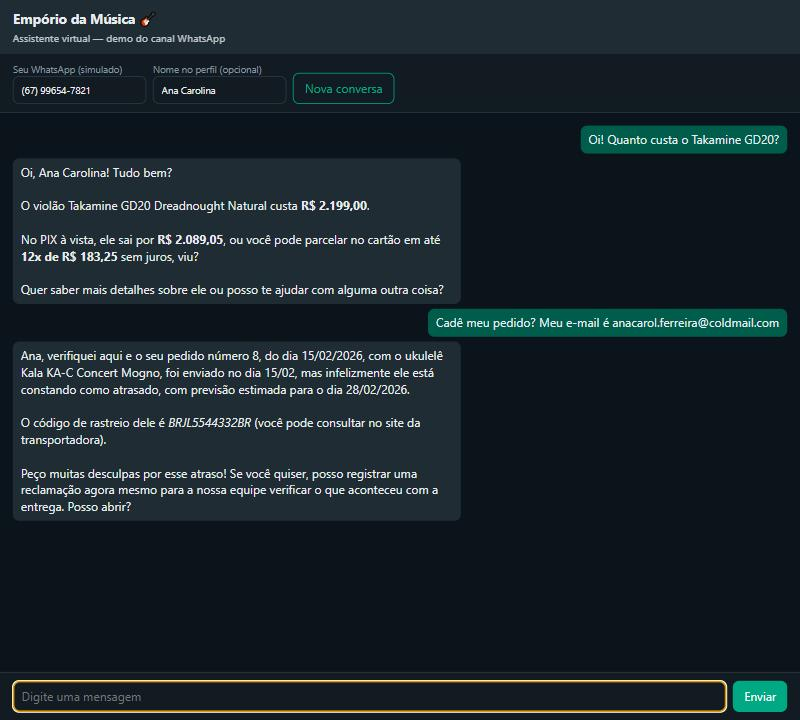

# Empório da Música — customer-service agent

A WhatsApp-style agent that answers the customers of **Empório da Música**, a
musical-instruments store in Campo Grande/MS, in Brazilian Portuguese: live prices,
stock and promotions, order status, returns and warranty, store information and
complaints — and a polite "not with me" for everything else.



- **Runs free**: Google Gemini's free tier by default, any OpenAI-compatible provider by
  changing three env vars.
- **Tested without an API key**: unit tests for every module, CI (ruff + mypy + pytest) on
  every push.
- **Measured against manipulation**: 20 adversarial attacks, 20/20 passed with
  zero data or price leaks ([report](docs/evals/adversarial-final.md)).

## How to evaluate in 15 minutes

| Read | What it shows |
|---|---|
| [`emporio/prompt.py`](emporio/prompt.py) | persona, scope as six jobs, the rules |
| [`emporio/agent.py`](emporio/agent.py) | the tool-use loop (~170 lines, no framework) and its failure handling |
| [`emporio/tools.py`](emporio/tools.py) | the three tools and identity injected from the channel ([validation](emporio/validation.py)) |
| [`docs/architecture.md` §3](docs/architecture.md#3-decisions) | the decisions, one short record each |
| [`docs/examples/`](docs/examples/) | five real conversations, reviewed against the spec |
| [`docs/evals/`](docs/evals/) | manipulation attacks: baseline 17/20 → final 20/20 |

## Run it

Python 3.12 and a free Gemini key (https://aistudio.google.com/apikey, no card). On
Windows, clone into a short path such as `C:\dev\` (pip fails on very long paths).

```bash
git clone https://github.com/henriqqw/emporio-da-musica-agent.git
cd emporio-da-musica-agent
python -m venv .venv
.venv/bin/pip install -r requirements-dev.txt   # Windows: .venv\Scripts\pip ...
cp .env.example .env                             # then set LLM_API_KEY=...
.venv/bin/python -m pytest                       # no key needed
.venv/bin/python -m emporio                      # http://localhost:8000
```

The page simulates the customer's WhatsApp number. Any number works for catalog and
policy questions; to see orders, use a test customer and give the e-mail when asked:

| WhatsApp | E-mail | Try |
|---|---|---|
| (67) 99654-7821 | anacarol.ferreira@coldmail.com | "cadê meu pedido?" → late order → complaint with protocol |
| (67) 99789-0123 | leticia.rocha@jmail.com | "me arrependi, posso devolver?" → return windows |
| (67) 98432-1098 | pedro.oliveira@jmail.com | two orders, one cancelled |

Other providers (OpenAI, Mistral, Groq, OpenRouter, Anthropic, local Ollama) are
ready-made blocks in [`.env.example`](.env.example).

## Architecture

```
channel (web demo / WhatsApp) ─▶ ChatService ─▶ Agent (tool-use loop) ─▶ any OpenAI-compatible LLM
                                                      │
                                                      └─▶ Tools ─▶ deterministic domain ─▶ CSV data
```

Dependencies point inward: the domain imports neither the LLM SDK nor FastAPI, so a
WhatsApp adapter is one more module on top ([design](docs/architecture.md#adr-06-channel-agnostic-core)).

## Key decisions

Each links to its record in [docs/architecture.md](docs/architecture.md).

- **Agent approach: function calling in a tool-use loop, policies in context** (ADR-01).
  Native tool use already is the ReAct cycle. **No RAG**: the 8-page manual fits whole in
  the prompt, and retrieval could drop a rule that depends on another (promotions don't
  stack with PIX). **No SQL agent**: model-written queries could expose another
  customer's data.
- **No framework** (ADR-02): three tools don't need LangChain; the loop is visible and
  tested with a fake client.
- **Deterministic domain, the LLM only writes** (ADR-04): prices, PIX, installments,
  return windows, complaint protocols and even money/date formatting are code with unit
  tests. A live test caught the model writing "R$ 599,99" for 599.9 before that.
- **Identity comes from the channel** (ADR-05): the phone is injected by the session, never
  a tool argument; orders also need the registered e-mail.
- **Model: configuration, free by default** (ADR-03, ADR-13): one `openai` client for any
  OpenAI-compatible API. Gemini Flash-Lite was chosen by measurement: each request carries
  ~4.4k tokens and a scenario run ~30 requests; Gemini Flash's free tier (20 req/day) ran
  out mid-run, Groq's tokens-per-minute cap was too low for this prompt. For production: a
  small paid model (e.g. Claude Haiku 5.5).
- **Prompt strategy** (ADR-10): one system message — static part (persona, rules, the
  whole manual) first so providers cache it, then a dynamic part (store time, opening
  hours, categories in stock). No few-shot; rules were tightened only where a live run
  failed.
- **Resistance to manipulation** (spec §10b): layers instead of patches — the model has no
  power to leak data or change prices; the prompt defines scope as six jobs; an
  adversarial eval with code checks and a calibrated LLM judge measures it.
- **Web channel hardening** (ADR-14): rate limit per phone and per IP before the LLM
  (no brute-forcing an e-mail, no burning the quota); strict CSP and security headers
  behind the page's HTML escaping.
- **History** (ADR-08): in memory per phone, restarted after 30 idle minutes.

Assumptions about the ambiguous parts of the case (two WhatsApp numbers in the manual,
conflicting installment rules, no delivery date in the data, …) are listed with the rule
applied in [docs/business-rules.md](docs/business-rules.md).

## Example conversations

Real runs on `gemini-flash-lite-latest` (`python -m scripts.run_scenarios`), reviewed
against the acceptance table in [spec §10](docs/spec.md#10-acceptance-scenarios):

| Conversation | Shows |
|---|---|
| [Catálogo e preços](docs/examples/catalogo_e_precos.md) | catalog search; PIX and installments from code; expired promotion |
| [Esgotado e promoção](docs/examples/estoque_e_promocao_ativa.md) | out-of-stock with alternatives; promotion without stacking PIX |
| [Informações e escopo](docs/examples/informacoes_e_fora_de_escopo.md) | address and hours; accessories and off-topic declined |
| [Pedido atrasado](docs/examples/pedido_atrasado_e_reclamacao.md) | **non-trivial**: identification, late delivery, complaint with protocol and deadline |
| [Devolução](docs/examples/devolucao_por_arrependimento.md) | **non-trivial**: wrong e-mail reveals nothing; return windows from the order dates |

## Known limitations and next steps

- LLM behaviour is checked by recorded runs and an adversarial eval reviewed by hand →
  automate the evals in CI on a schedule.
- Free-tier quotas are small and Google may use free-tier prompts → a small paid model.
- Sessions and rate-limit counters in memory, single process; expired sessions never
  evicted → Redis with TTL for both, async endpoints.
- Complaints go to a local JSONL file and nobody is notified → helpdesk integration
  (`ComplaintStore` is the only class to change) and bot pause on handoff.
- Small wording slips remain (e.g. calling the order date the dispatch date); every
  number and date comes from code.

## How AI assistants were used

I worked with **Claude Code** (Claude Opus 5.5) as a pair programmer in a spec-driven
workflow, keeping the decisions: it read the case and data and drafted the spec, business
rules and plan, which I reviewed before any code; open questions (contact numbers,
registering complaints, the model) came back to me. I redirected the design when needed
— asking how an evaluator would run a project tied to one paid provider led to the
provider-agnostic client; asking for current research led to Gemini Flash-Lite; a manual
"write a music code" test led to the adversarial eval. Implementation went in small
commits with tests; live runs exposed real problems (free quota, rate-limit latency, a
wrong price format, a hallucinated category, an over-lenient judge), each fixed in its
own commit — see the git history.

## Going deeper

[Spec](docs/spec.md) (intents, tools, acceptance scenarios and their traceability) ·
[Business rules](docs/business-rules.md) (every rule with its source or assumption) ·
[Architecture and ADRs](docs/architecture.md) · [Plan](docs/plan.md) ·
[Evals](docs/evals/) · [Policy manual as used by the agent](knowledge/policies.md)
